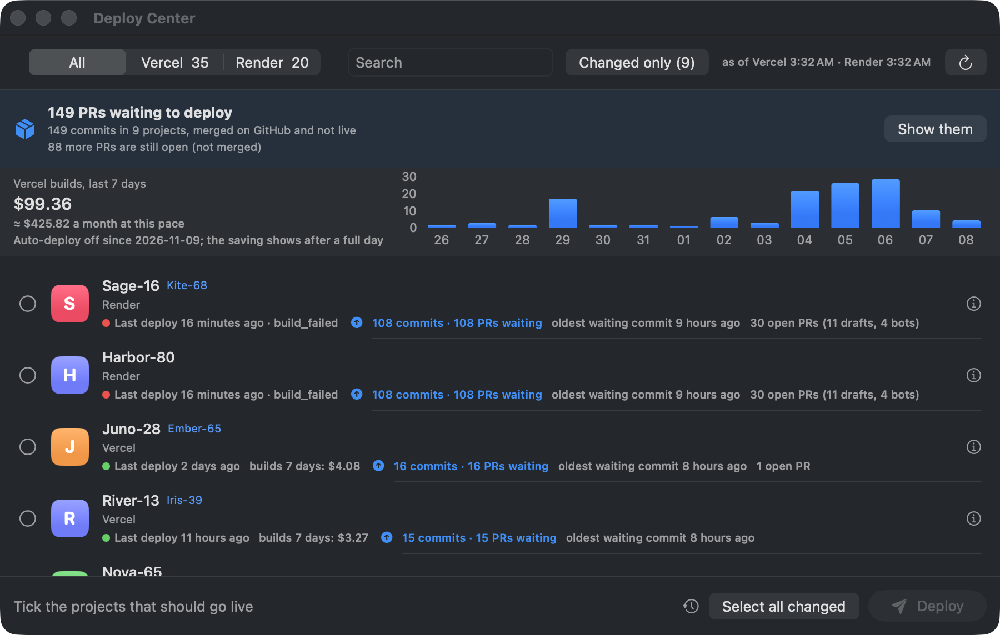

<p align="center"><a href="README.md">English</a> · <b>Deutsch</b></p>

<h1 align="center">Deploy Center</h1>

<p align="center"><b>Auto-Deploy bei Vercel und Render abschalten. Was sich geändert hat, mit einem Klick deployen.</b><br>
Dein Agent pusht 40-mal. Du deployst einmal.<br>
Passt bestens zu Claude Code: Der Agent pusht, du entscheidest, was live geht.</p>

<p align="center">
  <a href="https://github.com/Pschmetzer/deploy-center/releases/latest"></a>
  
  <a href="#installieren"></a>
  <a href="LICENSE"></a>
</p>

<p align="center"></p>
<p align="center"><sub>Die echte Build-Rechnung des Autors: 99 $ in 7 Tagen. Projektnamen im Demo-Modus ausgeblendet.</sub></p>

## Installieren

```bash
brew tap pschmetzer/tap && brew trust pschmetzer/tap && brew install --cask deploy-center
```

Oder [das Zip herunterladen](https://github.com/Pschmetzer/deploy-center/releases/latest), entpacken und
**Deploy Center** in *Programme* ziehen. Kostenlos, MIT, von Apple signiert und notarisiert.
Website: [deploycenter.app](https://deploycenter.app).

<details>
<summary>Hinweise zu Homebrew und Voraussetzungen</summary>

Homebrew 6 fragt einmal, ob du einem fremden Tap vertraust (`brew trust`). Ohne Admin-Rechte hängst du
`--appdir="$HOME/Applications"` an. Updates: `brew upgrade --cask deploy-center` oder **Jetzt aktualisieren** in den Einstellungen.

| Was | Wofür | Installieren |
|---|---|---|
| macOS 15 oder neuer, Apple Silicon oder Intel | die App | |
| `jq` | alles (die App fragt danach, wenn es fehlt) | `brew install jq` |
| Vercel CLI, braucht Node.js | Vercel | `npm i -g vercel`, dann `vercel login` |
| Render-API-Key | Render | dashboard.render.com → Account Settings → API Keys |
| GitHub CLI `gh` | optional: was wartet (*Neue Änderungen*, Commits und PRs) | `brew install gh`, dann `gh auth login` |

Die App findet `vercel` aus nvm, volta oder fnm nur, wenn deine Login-Shell sie einrichtet (`~/.zprofile`, nicht nur `~/.zshrc`).
Siehe [Troubleshooting](docs/TROUBLESHOOTING.md#vercel-is-installed-nvm-volta-fnm-but-the-app-does-not-find-it) (Englisch).
</details>

## Warum

Jeder Push baut jedes verbundene Projekt, und Build-Minuten kosten Geld. KI-Coding-Agenten pushen
viele Male am Tag, da kommt einiges zusammen. Einmal am Tag per Klick deployen kostet einen Bruchteil,
und nichts geht aus Versehen live. Probier den [Kostenrechner](https://deploycenter.app/#calc).

## So funktioniert's

1. **Verbinden.** Vercel nutzt dein `vercel login`. Für Render fügst du einen API-Key ein; er liegt im macOS-Schlüsselbund.
2. **Auto-Deploy abschalten.** Ein Klick für alle Projekte. Ein Push baut ab jetzt nichts mehr.
3. **Deployen, wann du willst.** Die App zeigt, was wartet. *Alle mit Änderungen anhaken* + *Deployen* ist das tägliche Deploy.

Neu dabei? [Sicher ausprobieren](docs/SAFE-START.md) (Englisch): erst schauen, dann ein Projekt, dann alle.

## Funktionen

- Schaltet Auto-Deploy für alle Vercel-Projekte und Render-Services auf einmal ab. [Was sich ändert](docs/AUTO-DEPLOY.md)
- Deployt den neuesten Commit, für ein Projekt oder viele, und verfolgt jedes Deploy, bis es live oder fehlgeschlagen ist
- Zeigt, was wartet: Commits und gemergte PRs, die noch nicht live sind, pro Projekt und insgesamt. [Wie gezählt wird](docs/ZAHLEN.md)
- Zeigt deine Vercel-Buildkosten
- Schätzt, was Auto-Deploy im Monat kosten würde und was das Abschalten seitdem gespart hat. [Wie geschätzt wird](docs/ERSPARNIS.md)
- Menüleisten-Symbol mit der Zahl wartender PRs und eine Mitteilung, wenn ein Deploy fertig ist
- Preview-Deploys (Vercel) und Rollback auf das vorige Live-Deploy
- Eine Bash-CLI, `deploys`, die all das ohne die App kann, auch unter Linux und in CI. [CLI-Referenz](docs/CLI.md)
- Erweiterungen: eine GitHub Action, Badges, eine tägliche Zusammenfassung an einen Webhook, ein Pre-Push-Hook, ein Docker-Image. [Integrationen](integrations/)
- Autofix: Ein fehlgeschlagener Build geht an eine Claude-Code-Routine, die einen Fix-PR öffnet. [Autofix](docs/AUTOFIX.md)
- Englisch und Deutsch

## Deploy Center + Claude Code

- **Autofix: Ein fehlgeschlagener Build repariert sich (fast) selbst.** Deploy Center gibt das maskierte Build-Log
  an eine Claude-Code-Routine, und Claude öffnet einen PR mit dem Fix. Nach deinem Merge deployt der nächste Lauf
  genau diesen Merge-Commit, einmal. Gemergt wird nie von selbst. [Autofix](docs/AUTOFIX.md) (Englisch)
- **Ein Deploy für viele Pushes.** Der Agent darf pushen, so oft er will; gebaut wird erst, wenn du deployst, was sich geändert hat.
- **Für Claude kopieren.** Im Build-Log eines fehlgeschlagenen Deploys kopiert ein Knopf den Fehler und das Log drumherum als Prompt, fertig zum Einfügen.
- *Kommt noch:* ein MCP-Server, damit Claude fragen kann, was wartet, und nur mit deinem OK deployt, und eine Übersicht dessen, was der Agent gepusht hat, zum Freigeben.

Mehr: [deploycenter.app/claude-code](https://deploycenter.app/claude-code/)

## Was es ändert, und wie du es rückgängig machst

| | Was Deploy Center tut | Rückgängig machen |
|---|---|---|
| **Vercel** | Entfernt die Git-Verbindung des Projekts. Vorher notiert es Repo und Branch in `~/.config/deploys/vercel-repos.json`. | Project → Settings → Git → Repository wieder verbinden. |
| **Render** | Stellt Auto-Deploy des Service auf *Off*. Der Service bleibt mit seinem Repo verbunden. | Service → Settings → Build & Deploy → Auto-Deploy → *On Commit*. |

Einen Befehl zum Rückgängigmachen gibt es nicht: Du schaltest Auto-Deploy im jeweiligen Dashboard wieder ein.
Deinstallieren schaltet es nicht wieder ein. Deploy-Hooks und GitHub-Workflows, die deployen, laufen weiter;
`deploys triggers` listet sie auf. Bei Render kann ein Blueprint mit Auto-Sync Auto-Deploy wieder einschalten:
Trag `autoDeployTrigger: off` bei deinen Services in `render.yaml` ein.
Details (Englisch): [Auto-Deploy aus und wieder an](docs/AUTO-DEPLOY.md) · [Deinstallieren](docs/UNINSTALL.md).

## Kommandozeile

```bash
deploys changed               # was auf GitHub gemergt und nicht live ist
deploys deploy-changed --yes  # alles davon deployen
deploys simulate              # Schätzung: Auto-Deploy im Monat vs. einmal am Tag
deploys ledger                # Schätzung: gespart, seit Auto-Deploy aus ist
```

Liegt in der App unter `Deploy Center.app/Contents/Resources/deploys`. Alle Befehle, CI-Variablen und
Einstellungen: [docs/CLI.md](docs/CLI.md) (Englisch).

## Roadmap

- [x] Vercel und Render: Auto-Deploy aus, Deploy, Preview, Rollback
- [x] Was wartet (Commits und PRs) und Vercel-Buildkosten
- [x] Menüleiste, Mitteilungen, Englisch und Deutsch
- [x] `deploys`-CLI, GitHub Action, Badges, tägliche Webhook-Zusammenfassung, Pre-Push-Hook, Docker-Image
- [x] Autofix für fehlgeschlagene Builds
- [ ] Netlify
- [ ] Cloudflare Pages
- [ ] AWS Amplify
- [ ] Allgemeiner Deploy-Hook (jede Plattform mit einer Deploy-URL)
- [ ] MCP-Server für KI-Agenten
- [ ] Raycast-Erweiterung
- [ ] Linux-Pakete für die CLI
- [ ] Team-Sync

Welche Plattform soll als Nächstes kommen? [Stimm per Issue ab](https://github.com/Pschmetzer/deploy-center/issues/new?template=platform-request.yml).

## Alternativen

- **Vercels Ignored Build Step.** In Vercel eingebaut und kostenlos. Ein Befehl pro Projekt entscheidet bei
  jedem Push, ob gebaut wird. Super für Monorepos und gut mit Deploy Center kombinierbar. Einen Ort, an dem
  du siehst und deployst, was wartet, gibt er dir nicht. Siehe [Glossar](docs/GLOSSARY.md#ignored-build-step) (Englisch).
- **Der Schalter im Dashboard.** Git bei Vercel trennen oder Auto-Deploy bei Render von Hand auf *Off* stellen.
  Für ein, zwei Projekte völlig in Ordnung. Bei vielen sind es viele Klicks, und du deployst aus jedem Dashboard einzeln.
- **Menüleisten-Apps, die nur den Status zeigen.** Sie zeigen den Deploy-Status, manche für mehr Anbieter, als
  Deploy Center unterstützt. Auto-Deploy lassen sie, wie es ist. Wenn du Builds nur beobachten willst, reicht das vielleicht schon.

## FAQ

**Was kostet es?** Nichts. Vercel und Render bezahlst du für die Builds, die du startest, und davon gibt es weniger.

**Deployt es etwas von selbst?** Nein. Es deployt, wenn du **Deployen** drückst oder einen `deploys`-Befehl
mit `--yes` ausführst. Ein geplantes Deploy richtest du selbst ein: [examples/](examples/).

**Wo liegt mein Render-Key?** Im macOS-Schlüsselbund. Er geht nur an api.render.com. Er gibt vollen Zugriff
auf dein Render-Konto.

**Schickt die App Daten irgendwohin?** Keine Telemetrie, kein Konto, kein eigener Server. Sie spricht mit
Vercel, Render und GitHub über deine eigenen Logins, mit deinen Websites für Logos und den Check nach einem
Deploy, und einmal am Tag mit GitHubs Release-Seite wegen Updates (abschaltbar in den Einstellungen). Fehler landen in `~/Library/Logs/DeployCenter.log` auf deinem Mac.

**GitLab oder Bitbucket?** Noch nicht. Deploys starten von GitHub.

**Windows oder Linux?** Die App braucht macOS 15. Die `deploys`-CLI ist Bash und läuft unter Linux und in CI.

Mehr (Englisch): [FAQ](docs/FAQ.md) · [Troubleshooting](docs/TROUBLESHOOTING.md) · [Glossar](docs/GLOSSARY.md) · [Alle Docs](docs/README.md)

## Mitmachen

Ideen und Fehlerberichte gern in den [Issues](https://github.com/Pschmetzer/deploy-center/issues).
Am meisten gesucht: GitLab neben GitHub, und Hinweise, wenn eine Zahl in der App falsch aussieht.
Kleine Aufgaben für den Einstieg: [Good first issues](docs/GOOD-FIRST-ISSUES.md). Bauen und testen:
[CONTRIBUTING.md](CONTRIBUTING.md).

```bash
./build.sh               # App und Zip in build/
tests/script-tests.sh    # die Regeln in deploys, ohne Netzwerk
tests/app-tests.sh       # die Regeln in der App
```

## Lizenz

MIT, siehe [LICENSE](LICENSE). Nicht verbunden mit Vercel oder Render.
Claude ist eine Marke von Anthropic; keine Verbindung.

[Impressum](https://deploycenter.app/impressum.html) · [Datenschutz](https://deploycenter.app/datenschutz.html)
