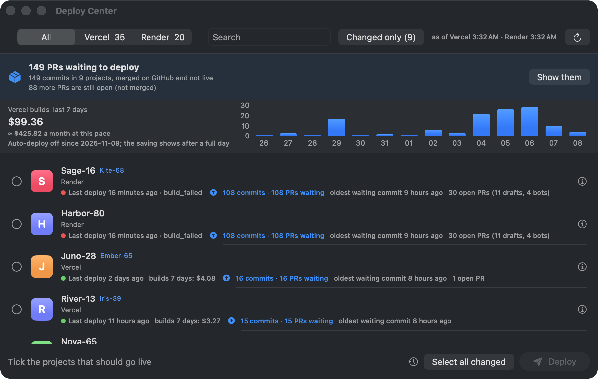

<h1 align="center">Deploy Center</h1>

<p align="center"><b>Stop paying for a build on every push.</b><br>
Turn off auto-deploy on Vercel and Render in one click. Deploy what changed in two.</p>

<p align="center">
  <a href="https://github.com/Pschmetzer/deploy-center/releases/latest"></a>
  <a href="https://deploycenter.app"></a>
</p>
<p align="center">
  <a href="https://github.com/Pschmetzer/deploy-center/releases/latest"></a>
  <a href="https://github.com/Pschmetzer/deploy-center/releases"></a>
  <a href="https://github.com/Pschmetzer/deploy-center/actions/workflows/ci.yml"></a>
  <a href="LICENSE"></a>
</p>

<p align="center"></p>
<p align="center"><sub>The author's real build bill: $99 in 7 days. Project names hidden by demo mode.</sub></p>

**Contents:** [Install](#install-in-30-seconds) · [Requirements](#requirements) · [Why](#why) · [What it does](#what-it-does) ·
[Connect your accounts](#connect-your-accounts) · [Command line](#command-line) · [Good to know](#good-to-know) ·
[Docs](#docs) · [Privacy](#privacy) · [Build from source](#build-from-source) · [Help wanted](#help-wanted) · [License](#license)

## Install in 30 seconds

**Homebrew**

```bash
brew tap pschmetzer/tap && brew trust pschmetzer/tap && brew install --cask deploy-center
```

Homebrew 6 asks you to trust a third-party tap once (`brew trust`). Without admin rights, add
`--appdir="$HOME/Applications"` to the install. Updates: `brew upgrade --cask deploy-center` or **Update now** in Settings.

**Or by hand:** download the zip from [the latest release](https://github.com/Pschmetzer/deploy-center/releases/latest),
unzip it and drag **Deploy Center** to *Applications*. It is signed and notarized by Apple, so it opens without a warning.

Then connect Vercel (`vercel login`), paste a Render API key, and press **Turn off auto-deploy**. [Details below](#connect-your-accounts).
New to it? [Try it safely](docs/SAFE-START.md): look first, then one project, then all.

## Requirements

| What | Needed for | Install |
|---|---|---|
| macOS 15 or newer, Apple silicon or Intel | the app | |
| `jq` | everything (the app asks for it if it is missing) | `brew install jq` |
| Vercel CLI, which needs Node.js | Vercel | `npm i -g vercel`, then `vercel login` |
| Render API key | Render | dashboard.render.com → Account Settings → API Keys |
| GitHub CLI `gh` | optional: what is waiting (*New changes*, commits and PRs) | `brew install gh`, then `gh auth login` |

The app finds `vercel` from nvm, volta or fnm only if your login shell sets them up (`~/.zprofile`, not only `~/.zshrc`).
See [Troubleshooting](docs/TROUBLESHOOTING.md#vercel-is-installed-nvm-volta-fnm-but-the-app-does-not-find-it).

## Why

If you push dozens of times a day, every push builds every connected project. Build minutes add up
fast. Deploying once a day with a click costs a fraction, and nothing ships by accident.
Try the [cost calculator](https://deploycenter.app/#calc).

## What it does

- **Turns off auto-deploy** for all your Vercel projects and Render services in one click.
  On Vercel the Git connection is removed (Deploy Center remembers the repo first);
  on Render auto-deploy is set to *Off*.
- **Deploys the newest commit** from GitHub with a click, for one project or many at once,
  and follows each deploy until it is live or failed.
- **Shows what is waiting**: the last deploy and its state, and a *New changes* badge when
  GitHub has a commit that is not live yet. *Select all changed* + *Deploy* is a daily deploy in two clicks.
- **Counts what is waiting**: how many commits and merged pull requests on GitHub are not live,
  per project and in total, and how many pull requests are still open.
- A menu bar icon with the number of PRs waiting. Opens with the last lists at once and reads them again every 15 minutes; a notification when a
  deploy ends while the window is in the background; ⌘R, ⌘F, ⌘1/⌘2/⌘3, ⌘A, Esc.
- **Preview deploys** (Vercel) and **rollback** to the previous live deploy, from the right-click menu.
- Site logos, domains to click, search, English and German.

## Connect your accounts

**Vercel** uses the login of the Vercel CLI on your Mac:

```bash
npm i -g vercel
vercel login
```

**Render** needs an API key: dashboard.render.com → Account Settings → API Keys. Paste it into the app.
It is stored in your macOS keychain and nowhere else.

**GitHub CLI** (`gh`, optional) lets the app show *New changes*. Without it everything else works.

## Command line

The app is a window over one bash script, `deploys`, which you can use on its own
(it is inside the app at `Deploy Center.app/Contents/Resources/deploys`):

```bash
deploys doctor                          # what is connected
deploys changed                         # what is merged on GitHub and not live: commits and PRs per project
deploys deploy-changed                  # the daily deploy: shows the list; add --yes to start it
deploys vercel map my-project me/my-repo main   # where a project deploys from, set by hand
deploys vercel list                     # which projects still deploy on push
deploys vercel autodeploy-off --all
deploys vercel deploy my-project        # newest commit to production
deploys vercel deploy my-project --preview
deploys render list
deploys render autodeploy-off --all
deploys render deploy my-service
deploys vercel rollback my-project
deploys status                          # what is building now, and what failed last
deploys watch my-project                # follow the newest deploy until live or failed
deploys logs my-project                 # the end of the newest build log
deploys open my-project [--dashboard]   # the site, or its page at Vercel/Render
deploys ignore my-project               # leave it out of changed / deploy-changed
eval "$(deploys completion zsh)"        # tab completion (also: bash)
```

Add `--json` to any command for the machine answer. On a server or in CI, `RENDER_API_KEY`
takes the place of the keychain and `VERCEL_TOKEN` is read by the Vercel CLI.

Settings live in `~/.config/deploys/`: `vercel-repos.json` (which repo and branch each Vercel project
deploys from, written when auto-deploy is turned off) and `vercel-team` (detected automatically).

## Good to know

- A project you disconnected **before** using Deploy Center has no remembered repo. Tell it:
  `deploys vercel map my-project me/my-repo main`.
- To go back to auto-deploy, reconnect the repository in the Vercel dashboard, or set
  auto-deploy to *On Commit* in Render. There is no command for it; see [Auto-deploy](docs/AUTO-DEPLOY.md#back-to-auto-deploy).
- On Render, a Blueprint with auto-sync can apply `render.yaml` again on push. Add
  `autoDeployTrigger: off` to your services there to keep it off.
- Your Render key gives full access to your Render account. It never leaves your Mac
  except in requests to api.render.com.

## Docs

- [Try it safely](docs/SAFE-START.md): look first, then one project, then all
- [Auto-deploy off and back on](docs/AUTO-DEPLOY.md): what changes per platform
- [Troubleshooting](docs/TROUBLESHOOTING.md): the error messages and what to do
- [FAQ](docs/FAQ.md) · [Glossary](docs/GLOSSARY.md) · [How the app counts](docs/NUMBERS.md)
- [Uninstall](docs/UNINSTALL.md): the app, the key and everything it kept
- [Examples](examples/): the daily deploy from CI, without a Mac

## Privacy

No telemetry, no account, no server of ours. The app talks to Vercel and Render with your own
logins, to GitHub through your `gh` login, to your own sites for their logos and the check
after a deploy, and once a day to GitHub's release page to see whether a new version is out
(Settings can turn that off). Errors are written to `~/Library/Logs/DeployCenter.log` on your Mac.

## Build from source

```bash
./build.sh            # app and zip in build/
./build.sh --install  # also copy it to ~/Applications
```

Needs Xcode or the Command Line Tools. No Xcode project: a few Swift files in `app/` and the
`deploys` script. Tests, no network needed:

```bash
tests/script-tests.sh   # the rules in deploys (a stand-in answers for gh)
tests/app-tests.sh      # the rules in the app
```
`./release.sh` signs, notarizes and zips a release (it needs a Developer ID; see the file).

## Help wanted

Ideas and bug reports are welcome in [Issues](../../issues). Most wanted: GitLab next to GitHub,
and reports when a number in the app looks wrong.

## License

MIT, see [LICENSE](LICENSE). Not affiliated with Vercel or Render.

[Legal notice (Impressum)](https://deploycenter.app/impressum.html) · [Privacy policy (Datenschutz)](https://deploycenter.app/datenschutz.html)
