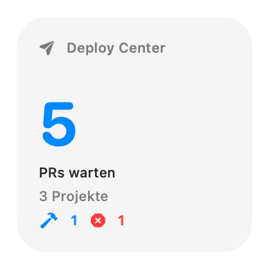
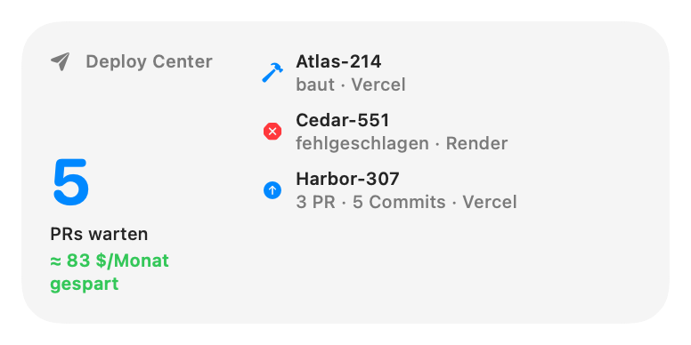
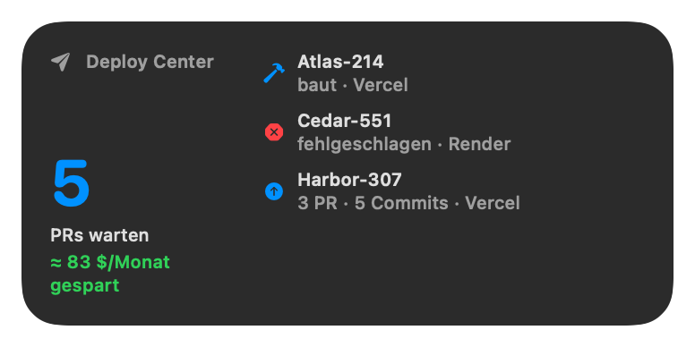
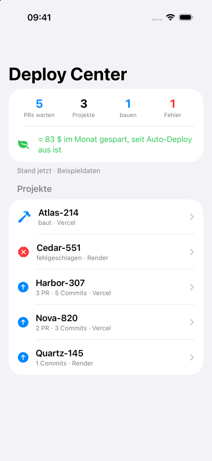
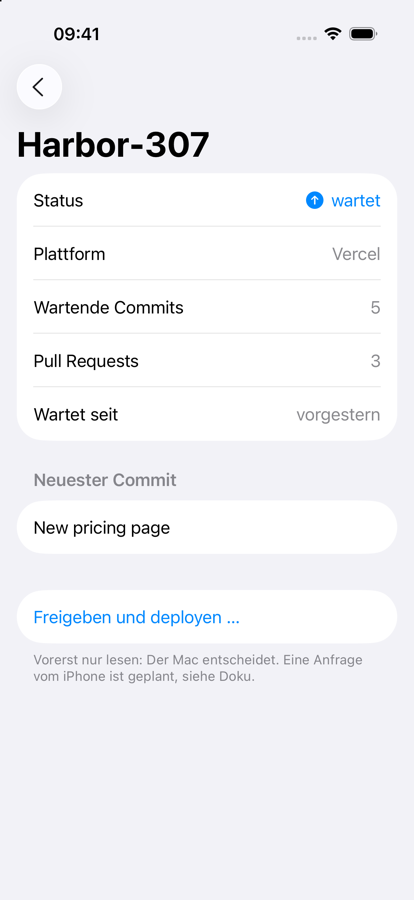

# Widgets and the iOS companion: the decision

Status: draft. The widget and the iOS app build on any Mac with Xcode. Real data on the widget
and on the phone needs steps in the owner's Apple Developer account first (listed at the end).

## What was checked

- Xcode 27.2 is installed; XcodeGen and Tuist are not. Nothing was installed for this work.
- A WidgetKit extension builds with plain `swiftc`, like the app: `-application-extension`, a
  normal `@main` entry (`LC_MAIN`, the same as Apple's own widget extensions), a bundle with
  `CFBundlePackageType = XPC!` and `NSExtensionPointIdentifier = com.apple.widgetkit-extension`,
  and the sandbox entitlement. An ad hoc build registers with `pluginkit`.
- The iOS app also builds with `swiftc` for the simulator, installs with `simctl` and runs.

## Decision 1: how the widget gets into the app

**Chosen: build the extension with `swiftc` in `build.sh`, opt-in with `--widgets`.**

| | swiftc in build.sh (chosen) | XcodeGen `project.yml` for the extension | Whole build as an Xcode project |
|---|---|---|---|
| New tools | none | XcodeGen on every build Mac | none, but a `.xcodeproj` in the repo |
| Plain build | unchanged, no Xcode needed | unchanged | needs Xcode; everything changes |
| Signing | in our script, visible | Xcode's automatic signing | Xcode's |
| Risk | Xcode-only steps later (App Intents metadata for configurable or interactive widgets) | a second build system next to build.sh | the biggest change, merge pain with parallel work |

- `./build.sh` without the flag builds what it built before; there is no `PlugIns` folder.
- `./build.sh --widgets` compiles `widgets/*.swift` + `shared/*.swift` into
  `Contents/PlugIns/DeployCenterWidgets.appex`, signs the extension first with its entitlements,
  then the app without `--deep` (which would drop them).
- If a later widget needs App Intents, a small XcodeGen project for the extension alone is the
  fallback; the app keeps its swiftc build.

## How the widget gets its data

After each list or cost reload the app writes `snapshot.json` (a few KB; the format is
`shared/DeploySnapshot.swift`) into the App Group container and asks WidgetKit to reload, only
when something changed. The widget never calls a network and never reads the app's settings.

- App Group: `<TEAMID>.app.deploycenter`. On macOS a group prefixed with the team id needs no
  provisioning profile (a `group.` one would). `build.sh` takes the team id from the signing
  identity and writes it into the entitlements and an Info.plist key (`DCAppGroup`); the Swift
  code reads the key. No team id lives in the repo.
- No identity (ad hoc build, or `DEVELOPER_ID=-`): no group, nothing is written; the widget
  should say "Open Deploy Center once", and the gallery preview should show made-up sample
  numbers (`context.isPreview`; not yet seen in the gallery, see "What was verified").
- Demo mode: names and commit messages are masked when the snapshot is written; turning demo
  mode on or off rewrites it.
- A tap opens `deploycenter://` (the app; a masked name could not select a project).
- Small: waiting PRs, waiting projects, building and failed counts.
  Medium: the same, the top 3 projects (building and failed first) and the saving a month.
- The hook in `Store.swift` is two calls to `writeSnapshot()`; everything else is in
  `app/Snapshot.swift`.

## Decision 2: where the iOS app gets its data

There is no server of ours, by design. Two real options:

| | iCloud key-value store (chosen) | A file in the owner's private GitHub repo |
|---|---|---|
| Where the data lives | the owner's iCloud | GitHub |
| Phone setup | none, same Apple ID | a GitHub token on the phone |
| Apple account steps | iCloud container, Developer ID provisioning profile for the Mac app, embedded by `release.sh` | none |
| Updates | pushed by iCloud, seconds to minutes | the phone polls |
| Size | 1 MB in all; ours is a few KB | fine |
| Write back (phone asks the Mac) | a second key | a second file |

**Chosen: `NSUbiquitousKeyValueStore`**, the smallest iCloud piece: one JSON blob under one key,
no CloudKit schema. CloudKit's private database would also work but is more than one blob needs.
A secret gist was ruled out: anyone with its URL can read it.

The iOS app reads through a small `SnapshotSource` protocol (`ICloudSource`, or `SampleSource`
when started with `-sample`), so the choice blocks nothing: without the entitlement it says "No
data yet"; with it, it shows the Mac's snapshot. The Mac side (writing the key) is not built yet; it needs the entitlement and profile
first, and is then a few lines in `app/Snapshot.swift`.

## Kept out of this draft, on purpose

- **Deploy from the phone.** A phone request that makes the Mac start a build is remote execution.
  The app already refuses to start builds from a URL for that reason (the `onOpenURL` comment in
  `App.swift`). The detail screen has the button and the confirmation, then says it only reads.
  Phase 2, if wanted: the phone writes a request key, the Mac shows it and the person confirms on
  the Mac (or a "trust my phone" setting the owner turns on).
- **Live Activity.** Updating one while the phone app is closed needs push from a server (APNs).
  Without a server it can only update while the app is open. Not built.
- **iOS widgets.** The widget views compile for iOS too, but an iOS widget needs an App Group and
  a provisioning profile on the iOS side, so it waits for the account steps.
- **A device or TestFlight build** is where a real Xcode project (or XcodeGen) becomes
  unavoidable for the iOS app: provisioning profiles and the App Store upload.

## Build and try

```bash
DEVELOPER_ID=- ./build.sh --fast --widgets
```

```bash
ios/build.sh --run
```

`ios/build.sh --run` installs into the booted simulator and starts with sample data.

## What was verified, and what not

Verified on this Mac:
- `./build.sh --fast` (plain) still builds, without a `PlugIns` folder; app tests pass; shellcheck clean.
- `DEVELOPER_ID=- ./build.sh --fast --widgets` builds; the extension carries the sandbox
  entitlement and registers with `pluginkit`.
- The widget views, rendered with `ImageRenderer` (the pictures below).
- The iOS app built with `ios/build.sh`, run in the iPhone 17 Pro simulator with `-sample`
  (list and details captured from the simulator).

Not verified:
- No build signed with the team identity; the App Group was never used.
- `writeSnapshot()` never ran against real data, and the widget was not seen in the gallery.
- iCloud: not set up, so `ICloudSource` never returned data.

## Steps only the owner can do (Apple Developer account)

1. Decide whether a release may carry the App Group entitlement (`<TEAMID>.app.deploycenter`,
   `build.sh --widgets` with the Developer ID). It changes the signed app; one notarized test
   build should confirm that notarization accepts it without a profile.
2. For iCloud: create an iCloud container (for example `iCloud.app.deploycenter`) and register
   the bundle ids `app.deploycenter.mac` and `app.deploycenter.ios` with iCloud key-value storage.
3. Create a Developer ID provisioning profile for `app.deploycenter.mac` with iCloud and keep it
   outside the repo (for example in `~/.config/deploys/`), so `release.sh` can embed it.
4. For the iPhone app on a device: an iOS App ID, a development profile, later App Store Connect
   and TestFlight.

## Screenshots (sample data)

| Small | Medium | Medium, dark |
|---|---|---|
|  |  |  |

| iPhone: list | iPhone: details |
|---|---|
|  |  |

The widget pictures are the widget's views rendered with `ImageRenderer`, not a capture of the
gallery: the ad hoc build registers with `pluginkit`, but showing it in the gallery with data
needs the signed build with the App Group.
